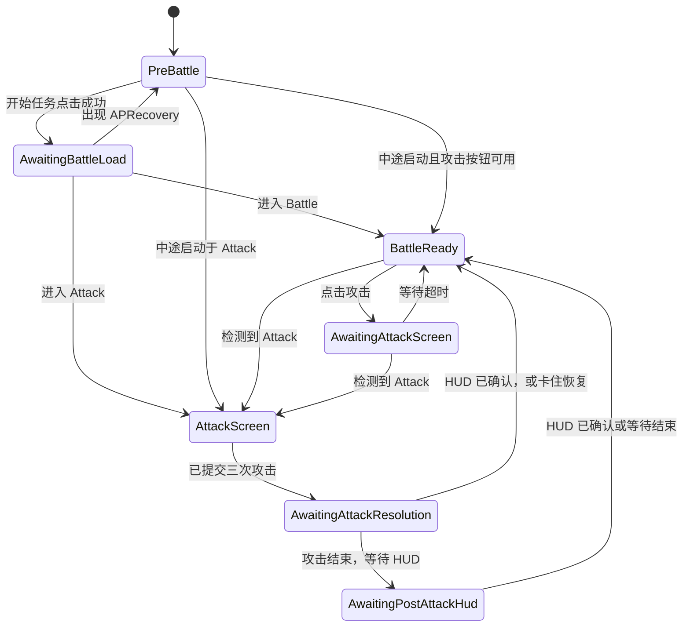

# 战斗自动化

实现位于 [runner/](../../src-tauri/src/runner/)，画面来自区服 `cv.json`，权威流程状态为 [BattleFlowState](../../src-tauri/src/runner/state.rs)。生命周期、模板错误和失败诊断见[公共约定](README.md)。

## 画面路由

| 画面 | 行为与下一步 |
| --- | --- |
| `SupportSelect` | 筛选助战，进入队伍确认；无匹配时滚动或刷新 |
| `TeamConfirm` | 校验队伍页与御主礼装，点击开始后等待加载 |
| `TeamChange` / `ServantSelect` | 战前队伍调整与成员选择，完成后返回确认 |
| `Battle` | 等待攻击按钮可用，再执行技能和敌方目标选择 |
| `Attack` | 确认速度、读取卡片与宝具、提交三次攻击 |
| `BattleResultBond` / `BattleResultExp` / `BattleResultLoot` | 依次关闭结算及升级提示 |
| `BattleResultFriendRequest` | 跳过好友申请 |
| `BattleResultContinue` | 重复关卡时返回助战选择，并重置战斗上下文 |
| `APRecovery` | 按配置恢复 AP，再交回页面路由 |

`TeamConfirm` / `TeamChange` 同时检测队伍栏和右下按钮以区分页面；助战页使用独立页面锚点。`BattleAction` 仅指攻击按钮已可用的处理阶段，不是独立画面。

## 内部状态

画面观察和动作完成通过 `BattleFlowEvent` 进入转换函数，无效事件不改变状态。`BattleState` 另存场次、回合、已执行动作、识别缓存及高级策略进度。

### 开始任务

- 每次点击前固定同一张临时 PNG，校验队伍确认页、开始按钮及已配置的御主礼装；校验后删除截图。点击成功才进入加载等待。
- 加载期间不重复执行战前操作。补点需距上次点击至少 3 秒、连续两次识别为队伍确认页，并用新帧重新校验页面和礼装；最多点击 3 次（首次加 2 次补点）。
- `Unknown` 或其他页面打断连续确认，不触发补点。加载等待按全局识别超时累计，补点或页面交替不重置计数。
- 到达 `Battle` 后仍需确认攻击按钮可用；进入 AP 恢复时退出加载等待，恢复后重新校验。

### 攻击提交与恢复

- `AwaitingAttackResolution` / `AwaitingPostAttackHud` 阻止重复提交。提交后持续停留在 `Attack` 达 5 秒，则返回 Battle，确认攻击按钮和菜单，再进入 Attack。
- 恢复时等待新卡片画面连续稳定两次并额外等待 1 秒，复用指令卡结果，按当前模式重读宝具。连续两次观察到离开 Attack 才确认恢复成功，否则保留缓存继续恢复。
- 卡片读取前先检测双箭头，再检测单箭头；速度为 1 时切换并等待速度 2。
- 点击宝具后出现“无法使用宝具”提示时，关闭提示，不计为已选卡，从尚未计划的可行动指令卡中补足三次攻击。
- 宝具采样时机、完整性和聚合规则见[宝具就绪检测](../np-readiness-detection.md)，场次与回合推进见[场景检测](../battle-scene-detection.md)。

## 技能与阵容

定向技能等待 `skill_target_close_button` 后选择己方目标，等待关闭后再跳过动画；令咒确认后使用 `command_spell_close_button` 同步。技能子选择在普通目标选择之前处理，支持选项类型、下标和数量；不支持的数量直接失败。

战斗换人使用 `order_change_close_button`：选择前后排后分别确认 SELECT 发光标记，仅确认失败的槽位才重试。两者确认后提交，等待弹窗关闭及攻击按钮恢复，不经过战前 `TeamChange` 路由。

动作链无法完成时停止，不标记回合已执行；动作后的攻击按钮等待窗口为 15 秒。`enemyTarget` 动作按序立即执行，turn 级敌方目标在全部准备动作后选择。

动作按[成员身份](../team-member-identity.md)解析。当前回合已执行的即时换人先应用；本回合宝具撤退及回合末变化在相应时机应用，避免提前改变阵容。

## 出卡与场景配置

普通配置位于 `battle_scenes.json`，HUD 场次选择 Battle，内部计数选择 `turns[]`；新 Battle 重置回合。超出已配置回合后仅复用最后的 `attackPriority`，不重跑技能和敌方目标。

| `attackMode` | 选择规则 |
| --- | --- |
| `normal`（默认） | 前三行决定最终卡位，缺失项由后续候选和从左到右补位；空固定行继承前一非宝具行，宝具不继承 |
| `critical` | 等待暴击率稳定 1 秒，枚举三卡顺序；优先三张满爆，否则依次尝试迅击 / 精湛连携、首张迅击、最高暴击率组合 |
| `advanced` | 按顺序采用首个完整匹配的三卡规则，否则从左到右选择可行动卡 |

暴击模式不使用宝具，优先避免相邻卡来自同一成员；精湛连携或首张迅击为每卡增加一次 20%，上限 100%，不叠加。先按配置的连携优先级，再按从者优先级和原卡位排序；识别或候选不足时放宽交错限制并记录警告。三种模式的配置独立保留。

- 五个固定卡位必须出现 suit / icon 信号。封印、眩晕、沉睡卡先排除，可选卡不足三张时再按卡位补齐。
- 前排配满三人时，归属识别连续三次失败后扩大到全部六名成员；前排不足三人时允许未知归属的可行动卡参与，并警告。
- 开启“优先选择暴击率更高的指令卡”时，仅在同成员、同色的等价候选间以暴击率打破并列；分数缺失仍按卡位排序。
- 无普通卡规则且未开启暴击率偏好时可跳过归属识别，普通卡按位置补位。

高级 / 冠位配置位于 `advanced_battle_scenes.json`。无有效启动条件时直接在 Battle 执行首条控制动作和 Turn 1；有条件时进入 Attack 等待，未满足的回合每次执行一条控制动作后无宝具攻击。启动后按实际顺序交错执行控制动作与 `turns[]`，旧 `startupActions` 兼容为 Turn 1；旧 `rules` 仍走原规则求值。自动换人和各职阶出卡顺序见[冠位战策略](../grand-battle-auto-strategy.md)。

Extra 火 / 风使用主副冠位，地 / 水使用光炮与单体。优先级为双宝具同色、双宝具普通、主输出同色追击、主输出追击、主宝具、次宝具，最后按冠位、主冠位及 Buster → Arts → Quick 补位；未配置的次角色对应规则自然跳过。

## 助战筛选

| 环节 | 条件 |
| --- | --- |
| 名称与形态 | 所选 variant 限定合法名称和宝具；名称重叠时必须同时命中对应宝具，名称与宝具都相同的形态无法区分 |
| 国服名称 | 优先 `name_cn_server`，缺失时用 `name_cn`；宝具文本必须是名称下方同一行的独立 OCR 片段 |
| 普通礼装 | 最多 10 张候选，任一匹配即可；启用满破要求时还须匹配满破图标 |
| 冠位礼装 | 三个位置分别校验，第 1 / 3 位最多 10 张候选，第 2 位单张；未配置位置跳过，启用的图标条件须全部通过 |
| 仅配置礼装 | OCR 所有可见行并按礼装筛选；从者和礼装都未指定时沿用首行选择 |
| 等级与星图 | 同时满足配置的宝具、技能、追加技能和分值下限；普通星图最高 62，冠位星图最高 16，非冠位忽略后者 |

需要另一技能面板时返回 `WaitingForPanel`，点击切换并重读；每候选的切换次数受 `SUPPORT_SKILL_PANEL_MAX_TOGGLE_TAPS` 限制。

助战职阶筛选方式按队伍保存，旧配置默认“只筛选对应职阶”。仅在指定助战从者时点击职阶页签；未指定时保持当前页签，沿用按礼装查找或首行选择。

| 方式 | 每轮查找顺序 |
| --- | --- |
| 只筛选对应职阶 | 对应职阶 → 列表穷尽后刷新 → 对应职阶 |
| 只筛选全职阶 | 最左侧全职阶 ALL → 列表穷尽后刷新 → ALL |
| 同时筛选 | 对应职阶 → 列表穷尽后切换 ALL → 再次穷尽后刷新 → 对应职阶 |

ALL 与最右侧全部助战 MIX 不同；ALL 点击位置按相邻职阶页签间距推算。切换页签不消耗刷新次数，并重置滚动、冠位区和技能面板查找进度。命中助战、刷新或开启下一项强化任务时重置职阶查找阶段。冠位区提前穷尽时也遵循相同的切换顺序。

国服 EXTRA 二级职阶筛选启用时，每次运行首次长按 EXTRA 2 秒，3 秒未见弹窗则重试，直到出现或取消。重置并选择具体职阶后，以 100 ms 短按“决定”，避免穿透；后续刷新只普通点击页签。

刷新需等待 `refresh_available`，JP 确认弹窗关闭后才恢复扫描。滚动按确认按钮锚点自适应并在终点停留，避免惯性；无锚点时使用固定后备距离，滚动条上下端在整条右侧轨道内、同一冻结帧上识别，横向对齐且上下顺序正确才确认滑块存在；滑块下端同时命中底部区域才视为穷尽。两端均未命中时先滚动一次再复查，持续缺失才按短列表处理；部分命中、位置矛盾或识别错误继续查找，不以首屏顶部标记缺失推断扫完。冠位判定改用头像右侧三张礼装区域上方、“概念礼装”旁的红色卷轴图标：按每行编队确认按钮投影小范围 ROI，按当前帧分辨率缩放共享图标模板，分数达到 0.80 才算冠位；不再以头像底部 ribbon 作为依据，调试框和逐行分数同步显示图标探针。冠位模式逐行判定：当前页出现任意可确认的普通助战行，就表示冠位区域已到末尾，即使同页仍有冠位行；先检查本页所有符合条件的冠位候选，没有匹配再结束本轮，不再向下滚动，也不等待第二页或历史命中。普通行和无法确认身份的行不作为冠位候选；图标位置被顶部职阶栏遮挡、越界、分数缺失或无有效行时视为未确认，不据此宣告末尾，继续依滚动条处理。冠位区域提前结束时仍执行并记录滚动条检测；调试日志同时显示冠位行、普通行、未确认行数量、逐行图标分数及末尾判定，刷新日志明确区分“当前页已出现普通助战，冠位区域已扫完”和“已到底部”；滚动日志中的“冠位模式 / 普通模式”仅描述配置，礼装和等级失败日志不再提前声称即将滚动。

## 结算与 AP 恢复

升级提示按对应结算页处理；装备 / 技能和御主升级提示优先于背景 Battle。活动奖励页复用战利品处理。

- 羁绊自动停止命中指定模式（任意升级或等级 `10+`）时结束。CN 先确认升级页身份，再匹配等级标签和数字。
- 五星礼装掉落停止在点击 Next 前检查前两行，运行内累计达到目标即停止，不持久化计数。
- 结算链临时 Unknown 可点击跳过点等待恢复；超过识别限制报错并归档诊断。
- AP 道具先按本次已确认次数过滤单类上限，再按优先级匹配图标；顶页扫描圣晶石 / 金 / 银，下滑扫描铜苹果。全部达到上限时结束。
- 国服兼容“物品”和“道具”标签。选择道具后至少等 500 ms，再定位确认按钮；确认后再等 500 ms，仍在 APRecovery 则等待，Unknown 则交回主循环。

## 国服强化任务

`RankUpQuestRuntime` 在普通战斗外层管理任务列表。仅支持 CN，启动首个已知画面必须为 `RankUpQuest`，否则在点击前失败。

1. 用同排“消耗”和“强化关卡”双锚点识别完整任务行；锁定或亮度不足的行不可点击。
2. 指定模式按截图的头像、名称、职阶签名重新定位，连续两帧可点击才进入；不用初始行号或 Y 坐标。参考图先缩放到当前完整帧，再裁签名区域。
3. 点击后以 `AwaitingDeparture` 防止重复操作；进入助战后复用普通战斗。最终点击结束返回列表，不使用普通重复按钮。
4. 指定任务完成一轮后连续两次变暗或消失即结束；尚未完成任何关卡就消失则报错。结算直接返回列表也计为本轮完成。
5. 全部模式从顶部到底部选择亮色完整行；一轮有任务则回顶复查，完整扫描无任务才结束。

忽略项目的普通重复次数，保留助战、战斗指令及 AP 恢复配置。

## 调试与测试

本地调试可注入一次第三张卡漏点以验证 5 秒恢复，或保存攻击前、暴击率缺失和战利品截图；截图失败只记警告。数字模型和影子模式规则见[场景检测](../battle-scene-detection.md#识别模式)。

流程转换、生命周期和场次推进由 [runner/tests.rs](../../src-tauri/src/runner/tests.rs) 覆盖，设备行为的离线验证边界见[贡献指南](../../CONTRIBUTING.md#测试)。
