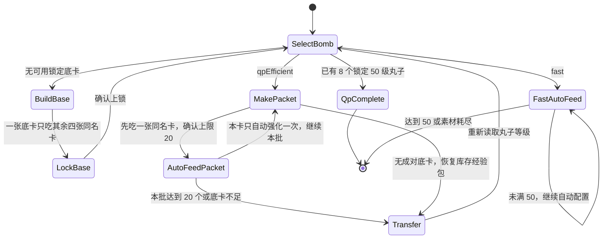

# 概念礼装强化

仅支持国服，由 [craft_essence_enhancement_runner/](../../src-tauri/src/craft_essence_enhancement_runner/) 独立执行，启动命令位于 [automation/craft_essence.rs](../../src-tauri/src/commands/automation/craft_essence.rs)。公共生命周期和错误处理见[自动化约定](README.md)。

| 策略 | 目标 |
| --- | --- |
| `qpEfficient` | 制作经验包并集中转移，补足 8 个锁定的 1 星 50 级丸子 |
| `fast` | 用 1 / 2 星未强化素材连续强化一个丸子，达到 50 级或素材耗尽即结束 |

两种策略均只操作符合条件的低星礼装，**不执行礼装解锁**。缺少已锁定底卡时，用 5 张同名 1 星制作满破底卡，再按下述规则安全锁定。

## 状态转换

不可确认的页面和卡片不推进状态。各次强化使用唯一待结算记录，返回主页面并校验目标上限后只结算一次。

## 网格与目标校验

- 用 `item_ce_bar_bronze` 定位完整卡片，一屏最多 21 张；底部空槽和滚动残片不参与。
- 每卡读取等级、上限与锁状态，并记录卡面指纹。1 星上限为 `10/20/30/40/50`，2 星为 `15/25/35/45/55`。
- 锁分数 `≥ 0.70` 视为已锁定，`≤ 0.50` 视为未锁定，中间为未知。任一完整卡无法确认时整帧不点击，连续 3 次失败停止。
- 丸子须为锁定、1 星、满破、上限 50 且未满级；同页优先最高等级。节省 QP 策略计入当前页已有的锁定 `50/50`，快速策略只处理一个目标。
- 新底卡只取至少有 5 张同名副本的未锁定 `1/10` 卡。合成后重新验证指纹、未锁定和满破上限 50，才进入锁定模式。
- 锁定模式只点击新底卡的已记录卡位，出现锁图标后立即退出。未确认锁图标则停止，绝不再次点击，以免反向解锁。
- 重新选择丸子时校验指纹、锁、星级、上限，以及等级不低于上次记录。

## 节省 QP 策略

### 制作经验包

1. 从未锁定 `1/10` 一星中选择底卡，当前列表至少还有一张同名副本。
2. 清空自动预选，只手动选择一张同名未锁定 `1/10`。同名须同时命中文字“突破极限”和黄色标记，不以卡面颜色代替。
3. 下一帧确认素材计数从 `0/20` 变为 `1/20`，执行强化；返回后必须确认上限为 20。
4. 推荐选择设为“仅 2 星 + 未强化”，每张经验包重新执行一次。明确提示无符合素材时才切到“仅 1 星 + 未强化”；一星也耗尽则正常结束。
5. 自动配置后直接强化，本卡只执行一次。结果上限可为 `20/30/40/50`，验证后登记入本批；当前等级读不全时仅可接受等级 ROI 内唯一、严格匹配的 `/20` 证据，不猜测当前等级。

单批最多 20 个，底卡不足时可提前转移。找不到成对底卡且本次无新批次时，保留已校验的丸子目标，扫描库存中未锁定、已升级、1 星且上限为 `20/30/40/50` 的经验包；不纳入原始 `1/10`、2 星或锁定卡。

### 转移经验

新制批次只喂入指纹匹配的已登记经验包，且每张均须未锁定、1 星、突破 1–4 次、上限 `20/30/40/50`。每批最多 20 个；提前满级则保留未用素材，未满级则继续下一批。

库存批次可在确认列表到底后按实际已选数量提交；无合格素材才按耗尽结束。已强化素材警告只在本批安全提交后处理，滑动解除的是本次“决定”按钮限制，不改变礼装锁。

## 快速策略

推荐配置初始化一次，严格开启 1 / 2 星及“未强化”，关闭 3 / 4 / 5 星和“已强化”，确认自动配置开启。每次强化返回读取同一目标的上限与当前等级：上限须为 50，未满级继续等待自动配置，确认 `50/50` 后结束。

持续无可强化素材或出现无符合素材提示时正常结束，不切换第二个丸子。

## 页面与交互约束

| 环节 | 必须确认 |
| --- | --- |
| 主页面 | `icon_enhancement_result` 与 `element_enhancement_ce_stripe` 同时命中 |
| 目标 / 素材列表 | `button_enhancement_ce_select_ce_mark`，以清空按钮区分素材页 |
| 手动选材 | 先清空意外预选，再核对游戏 `N/20`；提交前须与程序记录一致 |
| 批量点击 | 仅连续点击同屏已安全识别的卡，下一帧统一核对数量；首次同名强化只点一张 |
| 强化结算 | 底卡 / 丸子 / 快速目标上限为 50，经验包首次为 20、自动强化后为 20–50 的合法档位 |
| 经验溢出 | 命中 `text_exp_overflow` 后关闭提示，保留待结算记录，继续双帧确认主页面 |
| 推荐选择 | 仅允许经验包第二次强化或快速策略阶段进入，其他阶段意外出现则停止 |
| 锁定模式 | 仅允许已确认未锁定的新底卡进入，其他情况立即停止 |

页面信号与当前阶段冲突时等待复核，不点击卡片。已结算后的残留确认框和结果页不再次推进。

列表使用最大密度、等级顺序和智能排序：丸子目标降序，底卡与素材升序；手动筛选只开启 1 星。每次筛选 / 排序后先复位列表并验证顶部，失败即停止。

本次运行首次进入筛选弹窗时，定位 `scroll_bar_enhancement_filter_top`，中心 `y ≤ 0.148` 才算到顶；最多拖动两次，无法确认则停止。列表翻页前检查 `ui_scroll_bar_end`，命中即按当前阶段处理穷尽；最多扫描 12 页作保底。点击和滑动保留物理坐标抖动。

策略与交互回归位于 [runner tests](../../src-tauri/src/craft_essence_enhancement_runner/tests.rs) 和 [CV tests](../../sidecar/cv-code/tests/)。
