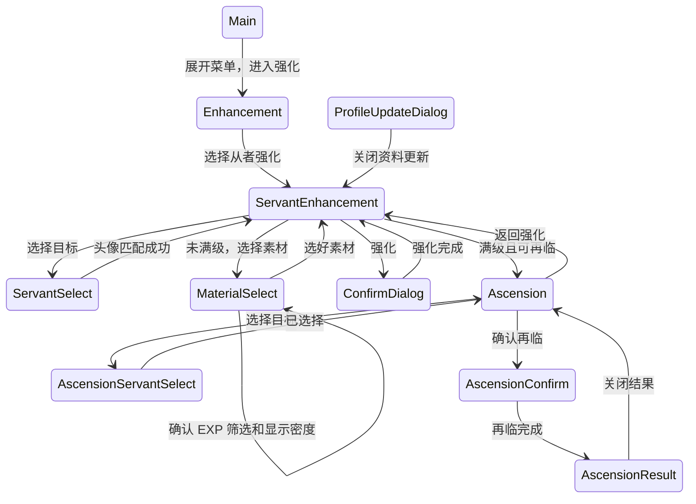

# 从者强化

仅支持日服。实现位于 [enhancement_runner.rs](../../src-tauri/src/enhancement_runner.rs) 及其同名目录，启动命令位于 [automation/enhancement.rs](../../src-tauri/src/commands/automation/enhancement.rs)。生命周期和错误处理见[公共约定](README.md)。

## 画面流程

选择页是所属 screen 的 variant；确认框和结果页部分依赖 OCR。

## 识别与模板

先匹配 screen anchor，再识别 variant，最后通过 element 判断菜单、筛选框和可执行状态。配置见 [JP cv.json](../../src-tauri/resources/servers/jp/cv.json)，默认 screen 阈值为 `0.85`，variant / element 阈值为 `0.80`。

| Screen | Anchor |
| --- | --- |
| `Main` | `button_notification` |
| `Enhancement` | `text_enhancement` |
| `ServantEnhancement` | `text_enhancement_servant` |
| `Ascension` | `screen_enhancement_ascension` |

| 视图 / 状态 | 模板或元素 |
| --- | --- |
| 主菜单展开 / 收起 | `button_enhancement` / `button_menu` |
| 从者强化主视图 | `text_enhancement_result` |
| 从者选择 | `text_enhancement_servant_select` |
| 素材选择 | `text_enhancement_material` |
| 素材筛选框 | `dialog_filter_setting` |
| 再临主视图 / 从者选择 | `text_ascension_main_variant` / `text_enhancement_ascension_servant_select` |
| 再临不可执行 | `enhancement_ascension_not_ready` |
| 最大列表密度 | `button_scale_level_3` |

国服不配置这些从者强化专用画面；国服礼装强化使用独立的 `CraftEssenceEnhancement` 配置。

## 执行条件

- 从者列表先确认最大显示密度；未命中时最多切换 3 次，再通过头像匹配目标。
- 素材页用 OCR 确认仅筛选 EXP 素材，确认显示密度后选择 20 个素材。`text_filter_setting_type` 只证明筛选标签存在，不能证明 EXP 选项已启用。
- 等级达到上限后，仅检查再临入口；再临处于 `NotReady` 时停止，报告素材不足或状态不可执行。
- 对话框 OCR 限定在中部文字区；等级和素材计数分别读取对应的小区域。

## OCR 与兼容路径

等级、已选素材数量、二次确认、资料更新和再临结果仍依赖 OCR 或既有坐标恢复。结果返回时优先使用 `button_enhancement_ascension_to_servant`。

替换这些路径需要可唯一识别确认框、资料更新、再临结果、素材数量和 EXP 三态筛选的模板；不要用单个标签命中代替完整状态校验。现有兼容路径见 [Fallback 注册表](../fallbacks.md)。

生命周期与流程测试位于 [enhancement_runner/tests.rs](../../src-tauri/src/enhancement_runner/tests.rs)，识别回归位于 [sidecar tests](../../sidecar/cv-code/tests/)。
