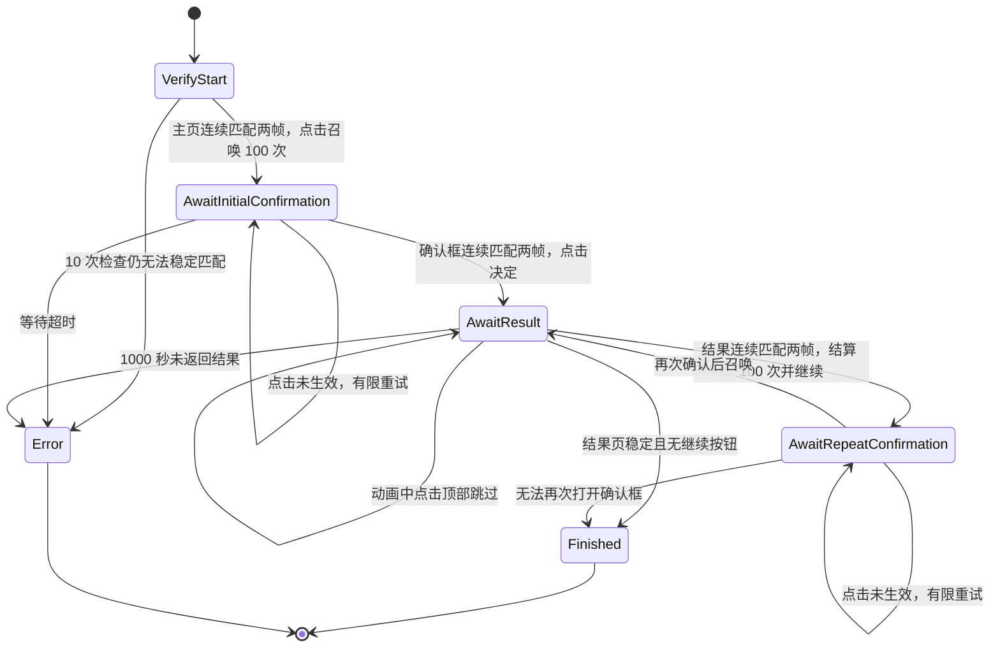

# 友情点召唤

仅支持国服，由 [friend_point_summon_runner.rs](../../src-tauri/src/friend_point_summon_runner.rs) 独立执行，启动命令位于 [automation/friend_point.rs](../../src-tauri/src/commands/automation/friend_point.rs)。生命周期、设备互斥和模板错误处理见[公共约定](README.md)。

## 状态转换

## 启动与卡池确认

用户先手动进入目标友情池。启动时确认召唤页面外壳，排除确认框和结果页，再记录临时主页特征；候选特征连续两帧匹配后才点击。主页特征只用于识别启动页面，不能证明卡池类型；每次“决定”前仍须连续两帧命中独立的友情点确认框。

主页比对标题和中央卡池画面两个区域，阈值均为 `0.90`，搜索范围向外扩展 `0.005`，避开余额和日期。候选采样后保持固定，未知页面不得覆盖；启动期间分辨率变化立即报错。

临时参考由应用级任务 handle 持有，不进入 sidecar 缓存。仅下一次被接受的手动启动会替换参考；停止、完成、失败或被拒绝的启动不清除它，应用退出时释放。

## 识别与交互

配置位于 [CN cv.json](../../src-tauri/resources/servers/cn/cv.json)，模板按 `templateReferenceWidth: 1920` 缩放。

| 探针 | 用途 |
| --- | --- |
| `screen_grand_summon` | 召唤页面外壳，限制候选捕获和辅助结果判断 |
| `text_grand_summon_friends_point` | 启动后流程的静态主页文字探针 |
| `dialog_grand_summon_friends_point_confirmation` | 以“自动变还设定”按钮识别友情点确认框 |
| `button_grand_summon_friends_point_continue_100` | 结果页继续按钮，按匹配中心点击 |

确认框优先于继续按钮、主页特征和页面外壳，避免弹窗背景绕过校验；确认探针不匹配金额或卡池说明，也不点击“自动变还设定”。

- 每个点击最多重试 3 次；无法解释的页面或超时停止。
- 动画每 400 ms 检查画面、每 1000 ms 点击顶部跳过，最多等待 1000 秒。
- 结果按钮连续两帧命中，或结果页外壳稳定但持续无继续按钮，才结算本批 100 次，避免重复计数。
- 确认框消失后短暂露出主页属于正常过渡，不据此停止。当前流程不自动往返变还或强化页面。
- 点击保留物理坐标抖动，具体区域以 runner 常量和配置为准。

## 事件与回归

`friend-point-summon-automation-status` 包含 `status`、`currentScreen`、`message`、`completedBatches` 和 `summonedCount`，计数由 Rust 维护。

[离线测试](../../sidecar/cv-code/tests/test_friend_point_summon.py)覆盖常规 / 限时池、1080p / 720p 缩放、压缩、余额与日期变化，以及标题替换和弹窗遮挡等负例。尚未覆盖所有卡池布局；特征不稳定时停止并调整采样区域。
